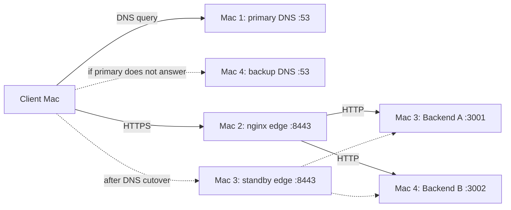
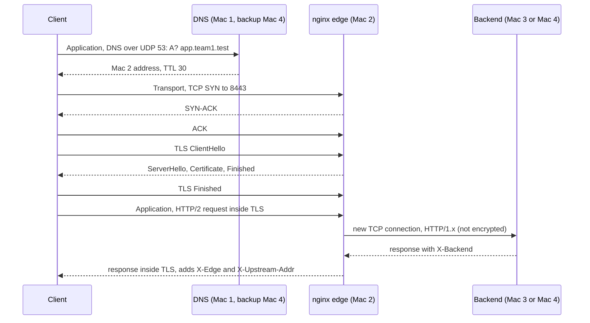

# System Architecture Specification (Phase 2)

## Overview

A private network service platform on **four Macs** on one Wi-Fi LAN: private DNS with a backup resolver, an nginx edge that terminates TLS and load-balances, two backends on separate machines, backend isolation with `pf`, and a standby edge for DNS-based cutover.

Phase 1 ran on three Macs, with both backends on Mac 3. That version of this document is in git history (commit `2faaaef`). Documents `02` to `09` describe the Phase 1 build.

## Machine roles and services

| Machine | Owner | Role | Software | Ports |
|---|---|---|---|---|
| Mac 1 | Abhishek | Primary DNS, test client | dnsmasq | 53 UDP/TCP |
| Mac 2 | Modi | Edge: reverse proxy, load balancer, TLS termination | nginx | 8080 (redirect), 8443 (HTTPS) |
| Mac 3 | Kapish | Backend A; standby edge (Ext E) | `backend/server.py`, nginx | 3001; 8443 and 8080 when standby |
| Mac 4 | Vikash | Backend B; backup DNS; test client | `backend/server.py`, dnsmasq | 3002; 53 UDP/TCP |

## IP inventory (Phase 2 lab session, 25 November 2026)

Addresses are not hard-coded in templates. They come from `~/cn-team.env`.

| Machine | Variable | IPv4 | Interface | Subnet mask | Default gateway | MAC address |
|---|---|---|---|---|---|---|
| Mac 1 | `MAC1_IP` | `10.7.30.25` | `en0` | `255.255.224.0` | `10.7.0.1` | `e4:43:89:f1:51:ed` |
| Mac 2 | `MAC2_IP` | `10.7.29.185` | `en0` | `255.255.224.0` | `10.7.0.1` | `06:1e:db:4d:fe:de` |
| Mac 3 | `MAC3_IP` | `10.7.1.253` | `en0` | `255.255.224.0` | `10.7.0.1` | `aa:b6:b8:36:70:b0` |
| Mac 4 | `MAC4_IP` | `10.7.23.21` | `en0` | `255.255.224.0` | `10.7.0.1` | `f6:d8:7f:02:21:a1` |

The subnet is `10.7.0.0/19`, and all four addresses are inside it. Each row was read on that Mac (`evidence/phase2/mac1/network-details.txt`, `evidence/phase2/network-details-mac2-4.txt`). Upstream DNS: `8.8.8.8`, then `1.1.1.1`.

DNS records, both resolvers, TTL 30 s: `app.team1.test` and `api.team1.test` point to Mac 2.

## Network topology

All traffic crosses the same Wi-Fi network. With backend isolation on, ports 3001 and 3002 accept only Mac 2, Mac 3 (standby edge) and loopback.

## Request flow by protocol layer

| Layer (TCP/IP) | Protocol | Role here |
|---|---|---|
| Application | DNS | Finds the edge address |
| Application | HTTP/2 to the edge, HTTP/1.x to backends | Requests, caching headers, load-balanced responses |
| Between application and transport | TLS 1.2 / 1.3 | Encryption and server identity, ends at the edge |
| Transport | UDP 53; TCP 8443, 8080, 3001, 3002 | DNS datagrams; reliable byte streams |
| Internet | IPv4, ICMP | Addressing and reachability (`ping`) |
| Link | Wi-Fi (802.11), interface `en0` | Frames on the LAN |

DNS can also use TCP 53. The client opens one TCP connection to the edge, and the edge opens a separate one to a backend. The client does not need to know any backend address.

## Resilience and remaining single points of failure

| Failure | What covers it | Limit |
|---|---|---|
| Primary DNS down | Backup resolver on Mac 4 | Lookups wait about 2 s before trying the backup; records are not synchronised |
| One backend down | nginx passive health check and retry on the other backend | Detected only when a real request fails |
| Edge moved or taken out of service | Standby nginx on Mac 3 and a DNS record change | Manual; clients move as their cached answers expire |

The **active edge is still a single point of failure**: if Mac 2 stops without warning, nothing changes the DNS record automatically. Removing it would need two live edges with automatic failover, for example a shared virtual IP (VRRP/keepalived on platforms that support it) or health-checked DNS records. Both backends and clients also depend on the same Wi-Fi network.

## Cloud equivalents

| Here | Cloud |
|---|---|
| dnsmasq, primary and backup | Managed DNS such as Route 53 |
| nginx edge | Load balancer (AWS ALB, GCP Load Balancing) |
| Backends | Application instances |
| pf rules | Security groups |
| DNS cutover to the standby edge | Blue/green traffic switch |
